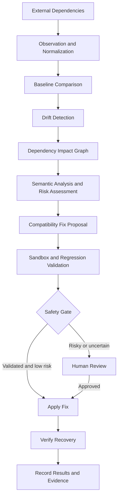

# Rebase — Autonomous Dependency Resilience Engine

> **The Internet After the API.**  
> Detect dependency drift. Understand its impact. Generate safe compatibility fixes. Verify recovery.

Rebase is a DevOps-focused dependency resilience platform designed to help engineering teams handle unexpected changes in external APIs, SDKs, MCP tools, and webhooks without manually diagnosing every downstream failure.

Instead of stopping at an alert, Rebase aims to connect dependency change detection with impact analysis, AI-assisted remediation, automated validation, and safe recovery.

---

## Table of Contents

- [The Problem](#the-problem)
- [Our Solution](#our-solution)
- [Core Workflow](#core-workflow)
- [Supported Dependency Categories](#supported-dependency-categories)
- [Key Features](#key-features)
- [System Architecture](#system-architecture)
- [Technology Stack](#technology-stack)
- [Current Prototype](#current-prototype)
- [Example Scenario](#example-scenario)
- [Safety and Reliability](#safety-and-reliability)
- [Existing Tools and Differentiation](#existing-tools-and-differentiation)
- [Target Users](#target-users)
- [Roadmap](#roadmap)
- [Project Vision](#project-vision)

---

## The Problem

Modern applications depend on external APIs, third-party SDKs, webhooks, microservices, and AI tool integrations. These dependencies evolve independently of the applications that consume them.

Even a seemingly minor dependency change can cause:

- API response parsing failures.
- Broken service-to-service communication.
- Unexpected application behavior despite valid schemas.
- Failed workflows and cascading service disruptions.
- Increased debugging time and emergency code changes.
- Production incidents caused by changes outside the team's control.

Traditional monitoring can identify failures, while contract-testing tools can detect certain incompatibilities. However, engineering teams may still need to trace downstream impact, develop a compatibility fix, test it, and verify that the affected application behavior has recovered.

**The challenge is not merely detecting that a dependency changed. It is understanding what the change breaks and restoring compatibility safely.**

## Our Solution

Rebase is being developed as an autonomous dependency resilience engine for DevOps and platform engineering teams.

It aims to connect dependency observation, change detection, impact analysis, remediation, validation, and recovery verification into a unified workflow.

Rather than simply reporting an incompatibility, Rebase is designed to help answer five questions:

1. **What changed?** Identify unexpected changes in dependency contracts or behavior.
2. **What is affected?** Trace the impact across dependent services and application workflows.
3. **How can it be fixed?** Generate a compatibility adapter, patch, or actionable remediation recommendation.
4. **Is the fix safe?** Validate the proposed change through relevant tests and safety policies.
5. **Has the application recovered?** Verify that the affected workflow behaves as expected.

The long-term goal is to reduce manual dependency-related firefighting while preserving engineering control over risky changes.

## Core Workflow

Rebase follows a dependency-resilience pipeline:

1. **Observe** — Collect dependency contracts, schemas, versions, events, tool definitions, and runtime observations.
2. **Normalize** — Convert observations from different dependency types into a common representation.
3. **Detect Drift** — Compare current observations against a known baseline.
4. **Analyze Impact** — Use a dependency graph to identify potentially affected services, functions, and workflows.
5. **Reason** — Explain the change and assess its likely impact using deterministic rules and AI-assisted semantic analysis where appropriate.
6. **Propose Remediation** — Generate a compatibility adapter, patch, or migration recommendation.
7. **Validate** — Execute contract checks, regression tests, and relevant safety checks.
8. **Apply Safely** — Allow eligible low-risk fixes to proceed under configured policies; route risky or uncertain cases for human review.
9. **Verify Recovery** — Confirm that the affected application behavior has recovered.

The intended outcome is a transition from reactive debugging to a more automated, evidence-driven dependency recovery process.

## Supported Dependency Categories

| Dependency type | Example change | Intended Rebase response |
|---|---|---|
| External API | Response field renamed or data type changed | Detect contract drift and propose a compatibility adapter |
| SDK | Method signature or return behavior changed | Identify affected callers and suggest a migration |
| MCP tool | Parameter schema or tool semantics changed | Detect incompatibility and assess semantic risk |
| Webhook | Event name or payload structure changed | Identify affected handlers and propose compatibility handling |

Support for these categories may differ by implementation stage. Each integration must be implemented and tested before it can be considered operational.

## Key Features

### 1. Dependency Drift Detection

Identify unexpected changes by comparing current dependency observations with a known baseline.

Potential signals include:

- Request and response schemas.
- Field names and data types.
- SDK versions and method signatures.
- Webhook event names and payloads.
- MCP tool definitions, parameters, and descriptions.
- Relevant runtime errors and behavior changes.

### 2. Dependency Impact Analysis

Represent relationships between dependencies, services, and downstream workflows in a dependency graph.

The goal is to help engineers identify the potential blast radius of a change rather than investigate every component manually.

### 3. AI-Assisted Remediation

Analyze detected changes and propose compatibility adapters, code patches, or migration recommendations.

Generated changes should remain proposals until they pass the required validation and safety checks.

### 4. Automated Validation

Evaluate proposed fixes using relevant contract checks, regression tests, and application-level workflow validation.

A successful patch operation alone is not proof of recovery. The affected behavior must also be tested.

### 5. Safety-Gated Recovery

Use explicit policies, validation results, and risk assessment to decide whether a fix can proceed automatically or requires human approval.

High-risk or semantically ambiguous changes should not be automatically applied simply because their schemas remain valid.

### 6. Engineering Dashboard

Provide a centralized view of detected changes, affected dependencies, remediation proposals, validation results, and recovery status.

The intended experience is an engineering workspace that helps DevOps and platform engineering teams investigate and resolve dependency-related incidents.

## System Architecture



The diagram describes the intended end-to-end architecture. Individual components may be implemented incrementally.

### Architectural Principles

- **Dependency agnostic:** Use a common observation model across different dependency categories.
- **Evidence driven:** Base remediation decisions on detected changes and validation results.
- **Safe by default:** Require stronger review for higher-risk modifications.
- **Incremental adoption:** Begin with simulated dependencies and expand toward real integrations.
- **Verifiable recovery:** Measure success by restored behavior, not merely by generated patches.

## Technology Stack

The current prototype uses or is structured around the following technologies:

| Layer | Technology |
|---|---|
| Frontend | React, Vite, TypeScript |
| Backend | Node.js, Express, TypeScript |
| Database | MongoDB |
| Development environment | Antigravity IDE |
| Validation | Scenario-based checks, contract validation, and regression testing |

Additional components for AI-assisted analysis, CI/CD integration, observability, and sandboxed remediation can be introduced as their corresponding capabilities are implemented.

## Current Prototype

The current demonstration includes an API dependency-change scenario using the NextGen Gear example application.

The demonstrated workflow is:

1. Introduce a simulated API response type change.
2. Detect the dependency drift through the Rebase dashboard.
3. Identify the affected dependency and downstream behavior.
4. Apply a compatibility adapter.
5. Validate the updated contract.
6. Refresh the application and verify that the affected behavior recovers.

This provides a concrete starting point for demonstrating the dependency-resilience workflow.

### Product Direction

The longer-term product direction is an engineering-focused platform for DevOps and platform engineering teams.

The proposed experience centers on:

- Dependency health and drift visibility.
- Service and workflow impact analysis.
- Compatibility remediation.
- Regression validation.
- Safety-gated recovery.

The existing e-commerce scenario serves as a demonstration fixture rather than the intended core customer experience.

**Implementation note:** The API-drift workflow is the current prototype focus. Broader SDK, MCP, webhook, AI remediation, and production CI/CD capabilities should be treated as future work unless separately implemented and tested.

## Example Scenario

### API Response Drift

Suppose a payment dependency initially returns:

```json
{
  "amount": 499
}
```

Following a provider-side change, the response becomes:

```json
{
  "total_amount": 499
}
```

An application that continues to read `amount` may fail or produce an incorrect result.

Rebase's intended workflow is to:

1. Detect the response contract change.
2. Identify consumers that rely on the old field.
3. Explain the likely downstream impact.
4. Propose a backward-compatible adapter.
5. Run relevant tests against the modified behavior.
6. Verify recovery before allowing the fix to proceed.

The goal is not simply to make a failing contract test pass. It is to restore the expected application behavior and provide evidence that the remediation works.

## Safety and Reliability

Automated remediation can introduce additional failures if generated changes are applied without sufficient validation.

Rebase is designed around the following principles:

- Human review for high-risk or ambiguous changes.
- Regression testing before applying generated fixes.
- Explicit policies for automatic remediation.
- Recovery verification after remediation.
- Traceability of detected changes and remediation decisions.
- Protection against semantically dangerous changes that preserve the same schema.

### Example: Semantic Risk

Imagine an MCP tool originally described as:

> Deactivate account.

The provider changes the tool's meaning to:

> Permanently delete account.

The input schema may remain unchanged, but the consequences are significantly different.

A schema-only validator could miss this semantic risk. Rebase aims to identify the changed meaning and require human review rather than automatically approving a potentially destructive action.

This scenario represents an intended safety capability and should be demonstrated only after the corresponding analysis and approval logic has been implemented.

## Existing Tools and Differentiation

Dependency contract testing, dependency update automation, observability, and security remediation are established areas with existing solutions.

Examples of relevant tools include:

- **Pact:** Consumer-driven contract testing.
- **Renovate:** Automated dependency updates and migration workflows.
- **Snyk:** Dependency security analysis and vulnerability remediation.

These tools address different parts of the broader dependency-management problem.

Rebase is exploring a unified workflow connecting:

- Unexpected dependency drift detection.
- Downstream impact analysis.
- Compatibility fix generation.
- Regression validation.
- Safety-gated remediation.
- Verified application recovery.

This is the proposed product differentiation, not a claim that existing tools cannot perform any of these functions. A deeper feature comparison is necessary to establish the precise market and research gap.

## Target Users

Rebase is intended for:

- DevOps engineers.
- Platform engineering teams.
- Backend developers maintaining distributed applications.
- Site Reliability Engineering (SRE) teams.
- Engineering teams working with multiple external dependencies.

These teams often need to maintain compatibility across systems they do not fully control.

## Roadmap

### Current Prototype Focus

- [x] Establish a simulated dependency-change scenario.
- [x] Build the initial API-drift demonstration workflow.
- [x] Integrate the initial dashboard and compatibility-remediation flow.
- [x] Demonstrate contract validation and recovery for the selected scenario.

### Planned Development

- [ ] Develop an engineering-focused dashboard experience.
- [ ] Expand dependency impact analysis across representative service workflows.
- [ ] Add a representative SDK compatibility scenario.
- [ ] Add a representative MCP tool-change scenario.
- [ ] Add a representative webhook-change scenario.
- [ ] Strengthen semantic risk assessment and human-approval policies.
- [ ] Integrate with CI/CD pipelines.
- [ ] Expand automated regression testing and recovery evidence.
- [ ] Evaluate Rebase against existing dependency-resilience and remediation tools.

Checklist items should be updated to reflect the actual repository state and repeatable test results.

## Project Vision

**Rebase aims to make applications more resilient to changes they do not control.**

By connecting dependency intelligence, impact analysis, compatibility remediation, and verified recovery, Rebase seeks to help engineering teams spend less time firefighting dependency failures and more time building reliable systems.

The long-term vision is a platform that can observe dependency changes, understand their consequences, recommend safe fixes, validate those fixes, and support controlled recovery across modern software ecosystems.

---

*Rebase is an evolving prototype. Feature availability and automation guarantees depend on the implementation, validation coverage, and configured safety policies.*
