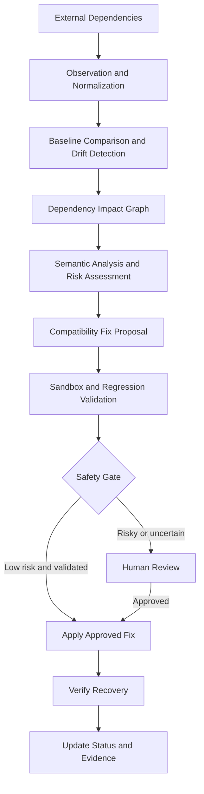

# AdaptX — Autonomous Dependency Resilience Engine

> **The Internet After the API.**  
> Detect dependency drift. Understand its impact. Generate safe compatibility fixes. Verify recovery.

AdaptX is a DevOps-focused dependency resilience platform designed to help engineering teams handle unexpected changes in external APIs, SDKs, MCP tools, and webhooks without manually diagnosing every downstream failure.

Instead of stopping at an alert, AdaptX aims to connect dependency change detection with impact analysis, AI-assisted remediation, automated validation, and safe recovery.

## The Problem

Modern applications depend on external services, third-party APIs, SDKs, webhooks, and AI tool integrations. These dependencies can change independently of the applications that consume them.

A change that appears small can cause:
- API response parsing failures.
- Broken service-to-service communication.
- Unexpected application behavior despite valid schemas.
- Failed workflows and cascading service disruptions.
- Time-consuming manual debugging and emergency patches.

Traditional monitoring may reveal that something failed, while contract testing can identify incompatibilities. Engineering teams may still need to determine the downstream impact, implement a fix, and verify that the affected workflow has recovered.

**AdaptX aims to close this gap by turning dependency changes into an actionable, validated remediation workflow.**

## Our Solution

AdaptX is designed around a unified dependency-resilience pipeline:

1. **Observe** — Collect dependency contracts, schemas, versions, events, tool definitions, and runtime observations.
2. **Detect** — Compare current observations against a known baseline to identify dependency drift.
3. **Analyze Impact** — Trace affected services, functions, and application workflows through a dependency graph.
4. **Reason** — Explain the change and assess its likely impact using deterministic rules and AI-assisted semantic analysis where appropriate.
5. **Propose a Fix** — Generate a compatibility adapter, patch, or remediation recommendation.
6. **Validate** — Run contract checks, regression tests, and relevant safety checks.
7. **Apply Safely** — Allow eligible low-risk fixes to proceed under configured policies; require human approval for risky or uncertain changes.
8. **Verify Recovery** — Confirm that the affected workflow behaves correctly after remediation.

The objective is to move from *detecting failures* to *understanding, repairing, and verifying dependency compatibility*.

## Supported Dependency Categories

| Dependency type | Example of a change | Intended response |
|---|---|---|
| External API | Response field or data type changes | Detect contract drift and propose a compatibility adapter |
| SDK | Method signature or return behavior changes | Identify affected callers and suggest a migration |
| MCP tool | Parameter schema or tool semantics change | Detect incompatibility and assess whether the action remains safe |
| Webhook | Event name or payload structure changes | Identify affected event handlers and propose compatibility handling |

The current prototype and future roadmap may support these categories at different levels. Each integration must be implemented and validated before being considered production-ready.

## Key Capabilities

### Dependency Change Detection
Compare observed dependency behavior or contracts against a baseline to identify unexpected changes.

### Dependency Impact Graph
Represent relationships between dependencies, services, and downstream workflows to help engineers understand the potential blast radius of a change.

### AI-Assisted Remediation
Explain detected changes and propose compatibility adapters or patches. AI-generated changes should be treated as proposals until validated.

### Automated Validation
Use contract checks and regression tests to evaluate whether a proposed fix preserves expected application behavior.

### Safety-Gated Recovery
Use explicit policies, validation results, and risk assessment to determine whether a fix can proceed automatically or requires human approval.

### Engineering Dashboard
Provide engineers with visibility into detected changes, affected dependencies, remediation actions, validation results, and recovery status.

## Architecture



This diagram describes the intended architecture. Individual components may be implemented incrementally.

## Technology Stack

The current prototype uses or is structured around the following technologies:

- **Frontend:** React, Vite, TypeScript
- **Backend:** Node.js, Express, TypeScript
- **Database:** MongoDB
- **Development environment:** Antigravity IDE
- **Testing and validation:** Contract checks, scenario-based testing, and regression validation

Additional technologies for AI-assisted analysis, CI/CD integration, observability, and sandboxed remediation can be selected as the corresponding features are implemented.

## Current Prototype

The current demonstration includes an API dependency-change scenario based on the NextGen Gear example application.

The prototype demonstrates the following workflow:

1. Introduce a simulated API response type change.
2. Detect the dependency drift through the AdaptX/Rebase dashboard.
3. Highlight the affected dependency and downstream behavior.
4. Apply a compatibility adapter.
5. Run contract validation.
6. Verify that the storefront's affected behavior recovers.

This scenario provides a concrete starting point for demonstrating dependency resilience. The longer-term product direction is an engineering-focused workspace for DevOps and platform engineering teams, rather than an e-commerce application.

**Important:** The SDK, MCP, webhook, broad AI remediation, and production CI/CD capabilities are part of the intended scope unless independently implemented and tested in the current codebase.

## Example Scenario: API Response Drift

Suppose a payment dependency initially returns:

```json
{
  "amount": 499
}
```

After a provider-side change, it returns:

```json
{
  "total_amount": 499
}
```

An application that still reads `amount` may fail or produce incorrect results.

AdaptX's intended workflow is to:

1. Detect the response contract change.
2. Identify consumers that rely on the old field.
3. Explain the likely downstream impact.
4. Propose a compatibility adapter that handles the new response.
5. Run relevant tests against the modified behavior.
6. Verify recovery before allowing the fix to proceed.

A successful schema check alone is not sufficient: the resulting application behavior must also be validated.

## Safety and Reliability

Automated remediation can introduce new failures if changes are applied without sufficient validation.

AdaptX is designed to prioritize:

- Human review for high-risk or ambiguous changes.
- Regression testing before applying generated fixes.
- Explicit policies for automatic remediation.
- Verification of recovery rather than relying only on successful patch application.
- Auditability of detected changes and remediation decisions.
- Protection against semantically dangerous changes that preserve the same schema.

For example, a tool that changes its meaning from “deactivate account” to “permanently delete account” may retain the same parameter schema. Such a change should trigger semantic risk analysis and human review rather than automatic remediation.

## Existing Tools and Differentiation

API contract testing, dependency update automation, observability, and security remediation are established areas with existing solutions.

AdaptX is being explored as a unified workflow that connects:

- Dependency drift detection.
- Downstream impact analysis.
- Compatibility fix generation.
- Regression validation.
- Safety-gated application.
- Verified recovery.

This is the proposed differentiation, not a claim that existing platforms cannot perform any of these functions. A detailed comparison against existing tools is required to establish the precise product and research gap.

## Roadmap

- [x] Establish a simulated dependency-change scenario.
- [x] Build the initial API-drift demonstration workflow.
- [x] Integrate the initial dashboard and compatibility-remediation flow.
- [ ] Develop an engineering-focused dashboard experience.
- [ ] Expand dependency impact analysis across representative service workflows.
- [ ] Add a representative SDK compatibility scenario.
- [ ] Add a representative MCP tool-change scenario.
- [ ] Add a representative webhook-change scenario.
- [ ] Strengthen semantic risk assessment and human-approval policies.
- [ ] Integrate with CI/CD pipelines.
- [ ] Expand automated regression testing and recovery evidence.
- [ ] Evaluate the system against existing dependency-resilience and remediation tools.

Roadmap items should be marked complete only after the corresponding functionality has been implemented and tested.

## Who Is It For?

AdaptX is intended for:

- DevOps engineers.
- Platform engineering teams.
- Backend developers working with distributed systems.
- Site Reliability Engineering (SRE) teams.
- Teams maintaining applications with multiple external dependencies.

The goal is to reduce the manual effort required to diagnose and recover from unexpected dependency changes while maintaining control over risky modifications.

## Project Vision

**AdaptX aims to make applications more resilient to changes they do not control.**

By connecting dependency intelligence, impact analysis, compatibility remediation, and verified recovery, AdaptX seeks to help engineering teams spend less time firefighting dependency failures and more time building reliable systems.

---

*AdaptX is an evolving prototype. Feature availability and automation guarantees depend on the implementation, validation coverage, and configured safety policies.*
